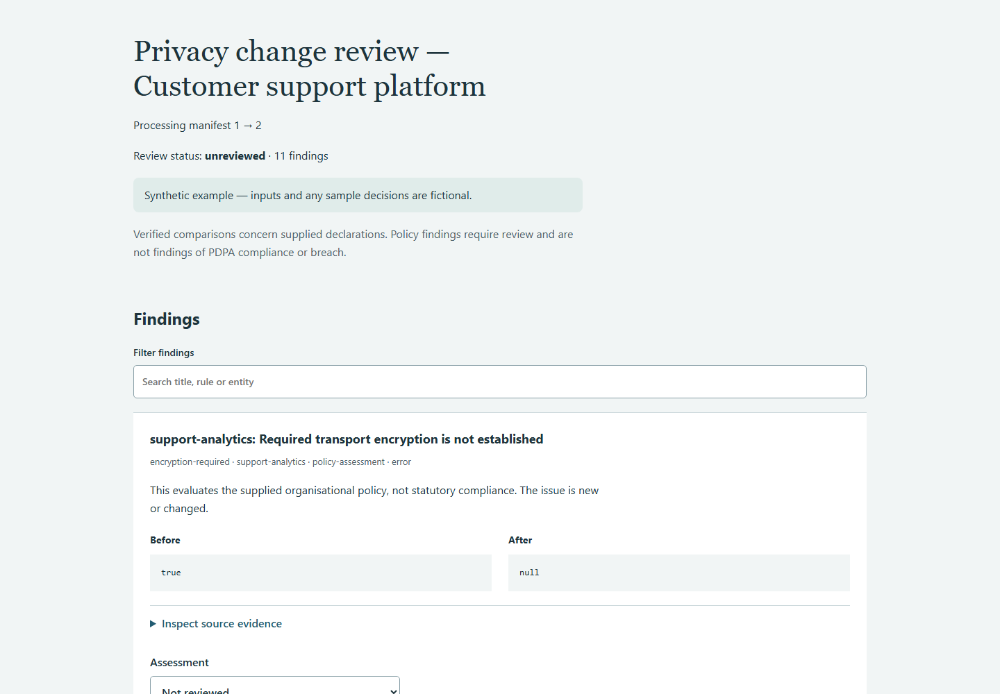

# data-flow-diff

[](https://github.com/kevanwee/data-flow-diff/actions/workflows/ci.yml)

**Detect privacy-relevant changes between processing manifests.** A standalone CLI and offline evidence-review workspace for privacy engineers, developers and DPO reviewers.



## A complete sample matter

A support platform adds vendor analytics, overseas processing, health-category data and longer retention.

The primary outputs are `report.json`, `report.md`, `findings.sarif` and `review.html`, with frozen before/after manifests and policy.

## Install and run

Requires Python 3.11 or later. Clone this repository and work from its root:

```bash
git clone https://github.com/kevanwee/data-flow-diff.git
cd data-flow-diff
python -m venv .venv
```

Activate with `source .venv/bin/activate` on macOS/Linux or
`.venv\Scripts\Activate.ps1` in PowerShell, then:

```bash
python -m pip install .
python -m data_flow_diff compare examples/support-platform/before.json examples/support-platform/after.json --policy examples/support-platform/policy.json --out out/change
python -m data_flow_diff verify out/change
```

Open `out/change/review.html` in your browser. The CLI and review run offline after
installation. No model API key, account, server or sibling project is required.
Samples describe fictional future drafts and plans; they make no claim of actual
execution, legal effectiveness or current law. See [sample licensing](examples/NOTICE.md).

## Complete the review

1. Inspect every finding, its classification, before/after values and source evidence.
2. Confirm, dismiss, correct the assessment, or record that more information is needed.
   Add a reason for every decision. A correction is an explicit reviewer overlay;
   original observations and source files stay intact.
3. Enter the reviewer's name/role, basis and authority. Download `review-decisions.json`.
   Names are supplied attestations, not authenticated identity or decision rights.
4. Place the downloaded decision in the repository root, then run:

```bash
python -m data_flow_diff finalize out/change --decisions review-decisions.json --out out/reviewed
python -m data_flow_diff verify out/reviewed
```

The final directory contains `report.html`, reviewed JSON/Markdown/SARIF, decisions,
source snapshots and a receipt hashing the exported files. Pending questions retain
`needs-information` status. Even a completed review can confirm unresolved substantive
problems; review completion does not mean compliance, a cleared licence or a correct
lease. No external system is changed.

Reports include configuration, the CI threshold, runtime versions, source hashes, source locators, scope assumptions and
review status. Package fingerprints bind decisions to the exact saved analysis. An
edited source, configuration or extraction requires a new analysis and new decisions.
Old output directories are never overwritten. The review renderer is versioned with
the engine; retain the same engine version when verifying old packages.

## Error and CI behaviour

Exit **0** means the requested analysis/export succeeded; it is not a legal clearance.
Use `--fail-on info`, `--fail-on warning` or `--fail-on error` for an explicit CI gate.
Exit **1** means findings reached that threshold; the report is still exported.
Exit **2** means invalid inputs or a refused operation, including stale/incomplete
decisions. Argument-parser errors also return 2. Default `--fail-on none` permits
interactive exploration without treating findings as an execution failure.

Unknown keys and schema versions are refused. JSON duplicate keys and non-finite
numbers are refused. A failed build publishes no partial matter directory. No-op
comparisons still produce an inspectable report; no findings does not establish legal
adequacy. Hashes detect accidental alteration, not malicious rewriting of all hashes
or independent source authenticity.

Keep original analysis packages alongside reviewed exports. These files can contain
confidential matter data. This repository's `.gitignore` excludes `out/`; choose local
storage consistent with your organisation's requirements. No data is uploaded by the tool.

## Development and verification

```bash
python -m pip install -e ".[dev]"
python -m pytest
python -m ruff check src tests
python -m pip wheel . --no-deps --wheel-dir dist
```

Versioned schemas are in `schema/`; `python -m data_flow_diff schema NAME` prints them.
CI runs Python 3.11/3.14 on Linux and Windows. Tests cover deterministic domain logic,
the complete analysis/review/export journey, invalid inputs, tampering, correction
overlays and preserved originals. See [acceptance evidence](docs/ACCEPTANCE.md) and
[the walkthrough](docs/SOP.md).

## Licence

MIT. The synthetic sample data and plan artwork are also MIT-licensed. Dependency
licences remain with their respective projects. No real client documents are included.

## Scope and method

Flows are matched by stable IDs. Data categories, purposes and countries are unordered
sets; field order is ignored. IDs changing appear as removal plus addition, never an
inferred identity match. Other strings are compared exactly and case-sensitively.

The supplied organisational policy checks destination-country labels, retention,
transport encryption, a recorded processing basis and sensitive data-category labels.
Checks run against **all after-flows**, including unchanged pre-existing issues. The
report distinguishes an observed declaration difference from a policy assessment.
Two-letter country syntax is checked; geopolitical recognition is not inferred.

This tool reads manifests, not network traffic, code instrumentation or live systems.
It does not establish a lawful basis or decide PDPA compliance. The example's policy
is fictional organisational policy, not a statement of statutory requirements.

## Correcting source facts

Correct a flow or policy in the source JSON and rerun compare into a new directory. Policy exceptions belong in a reasoned review assessment; they do not silently rewrite the policy.

## Invalid and contradictory inputs

Duplicate IDs, unexpected keys, invalid country syntax, negative or boolean retention values, malformed JSON, contradictory system identities and mixed synthetic status are rejected. Unknown retention or encryption remains visible and can trigger policy findings.


## Optional browser regression

Install the developer browser tool locally:

```bash
npm install --prefix out/browser-tools playwright
npx --prefix out/browser-tools playwright install chromium
node scripts/verify_browser.mjs
```

The script uses your active `python` by default (`PROJECT_PYTHON` can select another).
It runs a synthetic analysis, desktop/mobile checks, an incomplete-review refusal,
downloads a synthetic corrected decision, finalizes it and verifies the exported report.
It creates a fresh namespace under `out/` and refreshes the README screenshot.
For a standalone distribution check, build a wheel and run `scripts/smoke_wheel.py
--wheel PATH_TO_WHEEL`. That test creates a clean environment outside the source tree.


## Harder subject matter

A larger synthetic matter, independent expected-result ledger and complete review/export
rehearsal are included. See [complex matter verification](docs/COMPLEX-TEST.md) for results,
known limitations and the one-command walkthrough. Version 0.1.1 preserves earlier
released artifacts; use the corresponding engine release to verify older analysis packages.
