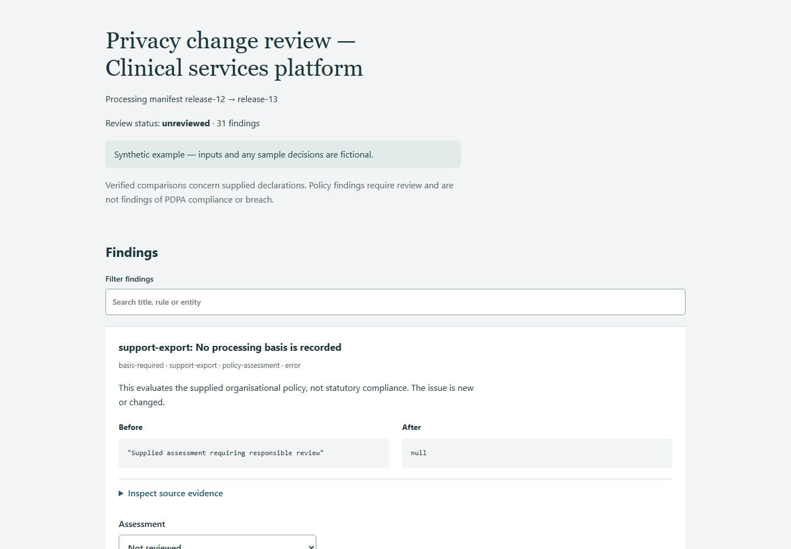

# Complex matter verification — 0.1.1

All inputs, parties, systems, plans and sign-offs in this rehearsal are synthetic.
Expected-result ledgers are authored independently of engine output and stored in
`examples/clinical-platform/expected.json`. They test calculations and recorded comparisons;
they do not provide independent legal or survey validation.

## Subject matter and results

A clinical services platform changes from 8 flows to 10. The case includes new
providers, downstream processing, overseas destinations, retention changes, sensitive
categories, unknown safeguards and pre-existing failures that remain unchanged.

The independent ledger expects 4 added and 2 removed flows, 10 changed fields, 9 policy
errors and 6 policy warnings: 31 findings. Set ordering alone produces no finding.
The three unchanged legacy errors remain visible and are identified as persistent.

The original 0.1.0 run produced 30 findings and missed the specific sensitive-category
flag for `Health ` against the policy label `health`. Version 0.1.1 flags that ambiguity
without silently changing the original declaration. It also rejects country labels
containing digits (such as `S1`) and blank owner/source/destination fields.

These are declaration and supplied-policy findings, not determinations of lawful
processing. The multi-hop example does not establish a complete live-system data lineage.
The simulated review leaves 4 findings pending for missing evidence or label clarification.



## Reproduce the complete journey

Install from the README, then run from the repository root:

```bash
python scripts/rehearse_complex.py --out out/complex-rehearsal
```

This synthetic-only command analyses the matter, freezes the evidence, records labelled
synthetic decisions, exports a reviewed report and verifies it. It deliberately leaves
unresolved questions pending. Open `out/complex-rehearsal/analysis/review.html` to make
your own review; save new decisions and finalize into a separate fresh directory.
The output `rehearsal.json` records finding/pending counts and states that no external
action or legal clearance has been established. Existing outputs are never overwritten.

For the actual browser regression, install Playwright as described in the README and
set `BROWSER_SCENARIO=scripts/complex-scenario.json` before running
`node scripts/verify_browser.mjs`. In PowerShell use
`$env:BROWSER_SCENARIO='scripts/complex-scenario.json'` first. It tests desktop/mobile,
filtering, incomplete-review refusal, correction overlays, decision download, final
export and pending-status preservation.

## Product status

50 local unit/end-to-end tests pass. The browser journey passes with no page errors
or horizontal mobile overflow. Full-suite and clean-wheel checks also run in CI.
See [the execution record](complex-verification.json) and the repository's Actions tab.

This is evidence that the bounded workflow executes on harder cases. It is not evidence
that the product can resolve arbitrary subject matter or replace responsible review.
